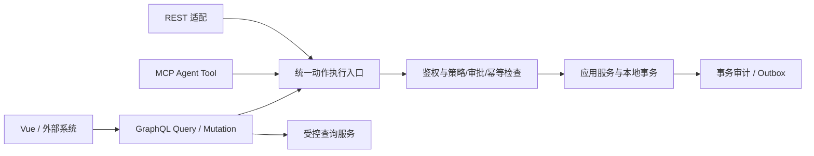

# 第 6 章 · GraphQL 与统一业务动作

**状态：** 规格草案。**ADR：** 010、019、026、035～036、044、056、059、066、068～072、078～080、084、088～091、095、097、115～116、130。

## 6.1 统一执行边界

GraphQL 是主要对外业务 API；REST 和 MCP 是适配入口。所有会改变业务状态的操作，其权威语义来自 TypeScript + Zod 定义的 **Action Contract** 和同一应用服务。GraphQL Mutation 不得直接绕开统一动作入口执行数据库写入；GraphQL Query 使用显式读取模型及受控查询服务，不直接暴露 ORM 实体。高频工业采集使用独立通道。

## 6.2 业务动作权威定义

动作的规范性元信息至少覆盖：动作唯一标识及版本、输入/输出 Zod Schema、生产风险分级、数据与工厂作用域、发起者/Agent 身份、授权和审批策略、幂等策略、可能副作用、超时语义、错误码、能力所有者、撤销和审计行为。字段表示是草案；关键是保证 **动作语义只有一个权威来源**。

- **普通用户委托**：调用携带真实用户身份、工厂/资源上下文及委托授权凭据；不得把用户权限自动扩展成 Agent 的全部权限。
- **后台服务 Agent**：采用限范围、限时、可撤销、限额度授权，运行时再次验证，不以“工具可见”判定可执行。
- **审批**：审批绑定动作、规范化后的参数摘要、目标资源版本/前置状态与截止时间；审批后的参数变更或状态过期应重新审批/校验。
- **业务幂等**：关键生产状态变更默认要求稳定请求 ID、唯一幂等键与持久化执行结果记录；跨 GraphQL/REST/MCP/Worker 的重复请求共用同一条执行语义。
- **提交结果未知**：客户端重连先查询稳定请求 ID 的状态，不能假设 HTTP 超时等于未提交；重试不能生成另一笔业务效果。
- **审计**：关键操作与本地事务原子提交。非关键诊断日志允许异步。

## 6.3 GraphQL 模块 Schema

- 模块自行声明其可见类型、字段、Query 和 Mutation；全部公开名字有所有权注册记录，重复定义或破坏现有 Schema 的安装需拒绝。
- 动态插件发布时构建、静态校验新的**不可变 Schema 快照**，并通过单实例原子切换；HA 多实例采用版本标识与就绪协调，兼容窗口允许短暂双版本，但路由必须与客户端操作兼容。
- Schema 字段弃用和过渡期优先，禁止以任意 Schema 删除代替插件停用。停用中字段可以仍存在，Resolver 返回明确不可用错误且不得继续执行已撤销的业务动作。
- 严格处理非空字段错误传播、执行中的旧请求对旧快照引用、Schema introspection 暴露信息的权限问题。

## 6.4 查询权限与负载治理

- 统一请求上下文包含身份、工厂、授权快照版本、请求追踪、超时预算、Locale 和可撤销性标志。上下文由可信服务端创建，客户端不得自行决定工厂 ID 或角色。
- Query 字段级、资源级、工厂级授权必须由框架与应用查询服务协同强制执行；Resolver 嵌套查询也不得绕过。
- 深度、复杂度、分页尺寸、总批处理成本、执行超时和速率限额统一治理；高风险查询可白名单；不存在无限分页接口。
- 防止 N+1：批量读取和执行预算是查询服务的能力，不允许动态插件绕过治理直接执行昂贵 SQL。
- 不把 GraphQL 作为 PLC 高频数据写入或必需的实时工业控制链路。

## 6.5 错误和版本语义

定义与协议无关的规范化错误类别：`UNAUTHORIZED`、`FORBIDDEN`、`INVALID_INPUT`、`APPROVAL_REQUIRED`、`APPROVAL_EXPIRED`、`PRECONDITION_FAILED`、`IDEMPOTENCY_CONFLICT`、`FEATURE_DISABLED`、`UNAVAILABLE`、`UNKNOWN_COMMIT_STATUS`、`INTERNAL_ERROR`。这些名字为草案，不是已批准的 wire enum。协议适配不得把关键拒绝错误变成“成功”。

版本策略：动作 ID 及输入契约独立版本化，GraphQL Schema 兼容扩展与弃用过渡；MCP 只导出当前 Agent 实际可授权的动作发现视图，运行时仍强制验证。

## 6.6 验证

- 对同一动作经 GraphQL / REST / MCP 请求得到一致业务结果、审批和审计，不能三套实现漂移。
- 通过构造跨工厂 GraphQL 嵌套 Query、越权字段、复杂度爆炸、非法分页和伪造身份上下文进行负向测试。
- 同一请求 ID 重复发送、提交后网络断开、业务版本变更、审批被撤销：不得产生重复确认事务或审批绕过。
- 插件停用后客户端继续执行已发布 Mutation：应安全拒绝，不触发业务服务。

**待验证：** Zod 到 GraphQL/JSON Schema 的表示保真（特别是 transform、自定义检查及不可映射类型）、Yoga 与 Fastify 的中间件/请求上下文协调、动态 Schema 的版本切换与拒绝逻辑。
