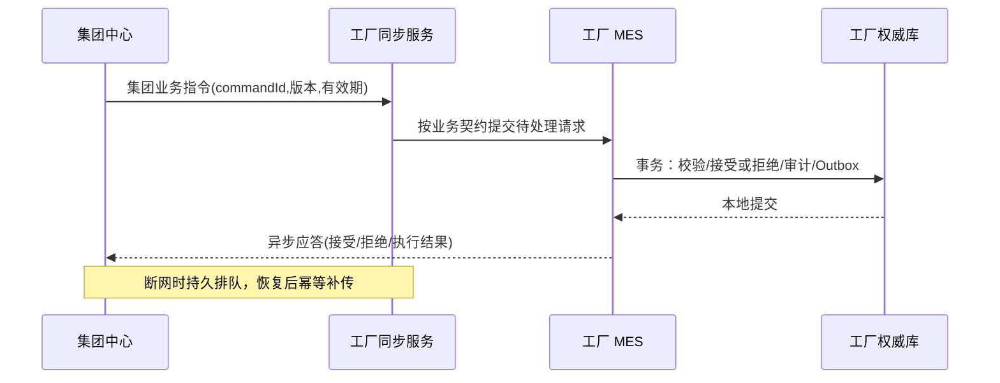

# 第 8 章 · 工厂自治与集团异步同步

**状态：** 规格草案。**ADR：** 008、014、016、022～023、030～031、039～041、049～052、067、097～099、121。

## 8.1 责任和数据权威

工厂拥有完整本地 MES 和生产业务数据库，是本地生产事务的唯一权威。集团共享库用于跨工厂汇总及集团级业务，按工厂隔离；集团业务指令是**待接受的远程请求**而非工厂数据库的直接写事务。每个数据类型有唯一权威写入方，非权威侧只能提交有记录的变更请求；拒绝双向最后写入覆盖。

## 8.2 通信契约

- 工厂产生可靠业务事件，连同业务修改通过本地 Outbox 在同一事务中持久化。
- 独立同步组件/Worker 负责发送和断线续传，至少一次交付；网络中断积压于本地持久化存储，不静默抛弃关键事件。
- 接收端按事件唯一 ID 去重，按业务实体的必要顺序处理（不得把所有工厂事件强制放在单条全局队列中）。
- 事件使用版本化契约；发布方与接收方可能不同步升级，因此需要兼容窗口、降级解析与明确拒收语义。
- 同步检查点标记**已被目标端持久接收并认可**的位置，而不是“本地已成功发出”。
- 具备事件补传、状态快照及对账修复策略，快照不得在无所有权校验的情况下覆盖本地权威生产状态。

## 8.3 典型流程

- 业务指令和生产状态变更是不同状态。中心收到“请求已接收”不能等同“工厂已执行完成”。
- 如果命令过期、版本不兼容或拒绝执行，集团能够明确观察拒绝/待人工处理状态。

## 8.4 离线容量、重新同步和冲突

- 由事件率、单事件大小、离线目标天数、冗余系数和剩余空间下限计算容量，形成每个项目的书面承诺；超阈值必须发出本地报警并保护关键存储。
- 网络恢复后执行版本协商、检查点核对、按可承受吞吐限速补传。正常业务不得被一次大规模积压回放压垮。
- 对账核对业务事件计数、序号缺口、事件去重记录及重点业务聚合状态；无法自动收敛时进入可审核的人工修复流程。
- 不用“最后修改时间覆盖”解决中心与本地同字段冲突。权威写入方明确后，其他侧变更请求需要业务审核/拒绝。

## 8.5 安全与审计

- 同步链路使用单独身份与最小授权，按工厂限定可见数据范围。
- 所有跨站点业务命令及执行结果携带稳定 correlation ID、command ID、版本、发起主体及状态；不可通过来自中心的自报角色绕过工厂本地校验。
- 集团统一身份目录同步到工厂可离线验证副本，断网时使用本地凭据、有效期与权限版本；本地紧急撤销优先立即生效，联网后补报中心。

## 8.6 验收场景

- 断网多天仍可本地登录并完成核心生产操作；不依赖集团在线。
- 同步重试/重复事件不产生重复业务效果；顺序乱序处理按业务实体契约决定阻塞或恢复。
- 检查点丢失、事件缺口、长时间离线、中心较旧版本及快照对账均能识别和恢复。
- 伪造集团指令、篡改工厂标识、过期身份授权必须被拒绝。

**待验证：** 长时离线容量基线、事件中断与恢复性能、工厂/集团版本兼容窗口，按 ADR-099/125/128 在测试中量化。

## 8.7 业务命令状态与数据权威细则

集团发送生产业务指令，应严格区分 `accepted`（工厂已经将指令受控受理）与 `executed`（真正完成生产业务变更）；网络超时或中心查询失败只能表示结果暂不可知，不能直接推断工厂拒绝。工厂应提供根据稳定命令 ID 核查进度的机制。指令必须含业务有效期、工厂目标、发起身份、资源版本及所需授权上下文；本地执行前始终重新验证业务状态、权限和幂等。

事件载荷应尽量表达“发生了什么”，而不是以数据库物理表行复制替代领域语义。订单主数据和生产结果如分别归不同权威侧，需要在数据字典中列明创建、修改、撤销及冲突的唯一责任人。集团可以给工厂下发新的业务主数据版本，但是否生效、何时对既有生产订单生效，应由工厂侧对应应用服务根据既有业务状态决定；同步组件不得直接 UPDATE 生产核心表。

## 8.8 对账、可观测性与故障闭环

至少监控未确认消息数量/字节量、最早积压时刻、同步检查点差距、重复率、无效事件、兼容版本失败、快照生成/应用及对账差异。事件确认可分为“传输接收”和“业务处理已持久化”，检查点必须采用适合当前订阅语义的后者。对于无法自动修复的差异，流程应保留完整证据与人工确认，不以覆盖权威生产数据为快捷方案。恢复期间应限流保护工厂在线生产事务。
