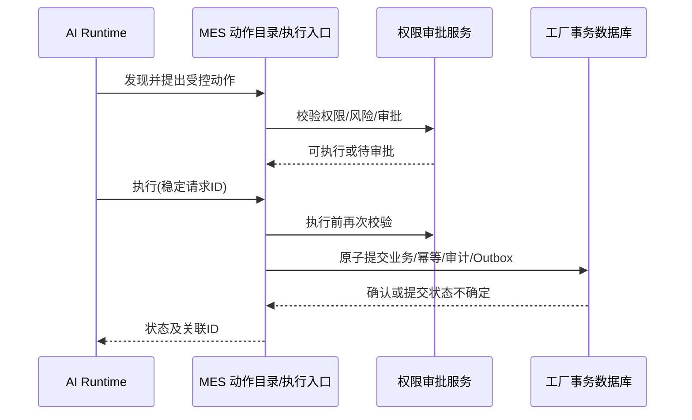

# 第 10 章 · AI Native 产品运行时与自主执行

**状态：** 规格草案。**ADR：** 004、010、019、026～028、035～037、044、056、065、071、080、084、087、095～097、103、109～110、130。

## 10.1 系统边界

AI Runtime 是与 MES 核心独立的可选运行服务，包含模型连接、Agent 编排、长期任务检查点、工具发现及工具调用协调。MES 核心仅接收受控业务动作调用并承担生产事务、授权判断、审批状态、幂等与审计。AI 故障或模型不可用不阻断核心 MES 生产功能，断网时允许 AI 降级。

**明确非目标**：让 Agent 直接执行生产关键 SQL、直连 PLC 控制生产、通过提示词代替审批、通过 Agent 缓存权限绕过服务端校验、在用户授权撤销后继续执行新动作。

## 10.2 Agent 身份与授权

- 用户委托式：保留用户真实身份、委托范围、工厂范围、到期时间和动作预算；授权不能因为 Agent 调用而扩大。
- 后台服务身份：使用独立服务主体和可撤销的有期授权，明确资源、动作、次数与配额，记录任务所有者和发起来源。
- 动作目录按 Agent 身份筛选；**发现≠执行授权**。执行时必须再次检查用户/服务身份、权限版本、审批、资源版本、风险分类及幂等。
- 权限撤销阻止后续动作；已提交事务不能被“撤销令牌”自动逆转。若需弥补，必须通过新的受控补偿业务动作执行。

## 10.3 动作调用状态模型

建议使用 `proposed → policy_checked → approval_pending → approved → executing → committed/declined/unknown → reconciled` 作为可观察的流程状态（字段与枚举仍待实现级规范）。关键约束：

1. Agent 产生结构化动作与规范化参数；服务端验证 Zod Schema，不能信任模型自述的身份及风险级别。
2. 按业务动作策略决定直接执行或等待审批；审批绑定动作 ID、参数摘要、目标资源版本与有效期。
3. 执行前再次检查审批/权限/资源版本和唯一请求 ID；重复调用只能得到原结果或安全的未知结果。
4. 应用服务在本地事务中写入关键审计和 Outbox；Agent 收到执行结果后更新自己的编排检查点，不能将编排状态替代 MES 事务结果。
5. 执行结果不确定时按稳定 requestId 查询；不能简单让 Agent 再次“尝试一下”。

## 10.4 模型接入和长任务

- 模型适配层可替换，模型选择、秘钥、调用额度属于 AI Runtime 设置，不应影响业务动作的服务端强制规则。
- Agent 编排检查点归 AI Runtime；MES 持有动作执行和生产事务权威。双方通过 correlationId 和 requestId 实现跨组件核查。
- 人工审批等待不得持有数据库事务和锁；重新恢复时重验参数、数据前置版本、权限版本及审批有效期。
- 运行时限额包括工具调用数、Token/费用预算、任务寿命、最大动作并发、外部连接目的地。具体上限由项目制定。

## 10.5 AI 原生扩展与发布

Code Agent 以机器可读模块、动作、插件、数据库迁移、GraphQL 和 UI 契约为输入生成代码，但所有发布通过 Git/CI、自动测试、评审、签名及**授权人员最终批准**。运行时 Agent 不具备调用生产环境任意上传 JS 包的能力。

## 10.6 验收

- Agent 越权跨工厂、超范围审批、参数篡改、授权过期/撤销、重复执行、审批等待后资源变更必须拒绝。
- AI Runtime 全部宕机时 MES 关键生产操作不受影响。
- 同一业务动作经人类 GraphQL 客户端与 Agent MCP 适配调用，授权、幂等与审计语义一致。
- 任务编排恢复过程中不能重复提交已经确认的 MES 生产状态。

**待验证：** 选定模型/SDK 的结构化输出可靠性、动作目录同步、长期任务恢复、审批异步通知渠道及 AI 工具调用预算。
